# Cashflow Lifeline: System Architecture

**PayPal AI Hackathon ("Build What's Next with PayPal and AI")**

Cashflow Lifeline finds the one upcoming payment a PayPal-paid freelancer is about to miss, compares the cheapest ways to protect it, and executes the plan the owner approves through PayPal.

---

## 1. High-Level Architecture Diagram

```mermaid
flowchart TD
    subgraph Frontend["Frontend Client (React + Vite + TypeScript + Tailwind)"]
        UI_Dash["Dashboard & At-Risk Banner"]
        UI_Chart["Interactive Recharts Timeline (CI Band + Plan Overlay)"]
        UI_Cards["Rescue Plan Cards (Plan A / B / C)"]
        UI_Super["Autonomous Supervisor Progress & Traces"]
        UI_WhatIf["What-If Financial Simulation Studio"]
        UI_Nego["Negotiation Studio (3-Tone Drafts)"]
        UI_Resil["Financial Resilience Score (0-100)"]
        UI_Timeline["Chronological Inflow/Outflow Ledger"]
        UI_Audit["Cryptographic Audit Log & Chain Verifier"]
    end

    subgraph API["FastAPI Application Layer (backend/app/api)"]
        Router_Auth["/auth (JWT, Registration, Login, Demo)"]
        Router_Supervisor["/supervisor (Multi-Agent Workflow Runs)"]
        Router_Simulation["/simulation (Presets, What-If Engine)"]
        Router_Negotiate["/negotiate (Tone-Specific Message Drafts)"]
        Router_Resilience["/resilience (6-Factor Score & Tips)"]
        Router_Finance["/finance (Position Summary & Timeline)"]
        Router_Forecast["/forecast (Multi-Horizon 7/30/60/90d)"]
        Router_Plans["/plans (Rescue Plan Generator)"]
        Router_Actions["/actions (Approve HMAC, Execute)"]
        Router_Webhooks["/webhooks/paypal (Verified Ingress)"]
        Router_Audit["/audit (Ledger, Verify Chain)"]
    end

    subgraph Guardrail["Deterministic Guardrail Security Layer (No LLM Decisions)"]
        SM["4-State Machine (proposed -> approved -> executed -> confirmed)"]
        HMAC["HMAC-SHA256 Signature Binding (Recipient, Amount, Currency, Action)"]
        Policy["Policy Bounds (5% Max Discount, $10k Cap, Whitelist)"]
        AuditLog["Hash-Chained Audit Trail (SHA-256 Chaining)"]
        Validator_Num["Strict Number & Metric Validator (Zero Hallucination)"]
    end

    subgraph Agents["Autonomous & Intelligent Agent Network"]
        Agent_Supervisor["Supervisor Agent (Orchestration & State Management)"]
        Agent_Forecaster["Forecaster Agent (scikit-learn + Monte Carlo + Bayes)"]
        Agent_Collector["Collector Agent (Target Scoring & Invoices)"]
        Agent_Treasurer["Treasurer Agent (Timing & Split Solver)"]
        Agent_Negotiator["Negotiation Agent (3-Tone Communication Engine)"]
        Agent_Planner["Rescue Plan Engine (Plan A, B, C Generation)"]
    end

    subgraph Storage["Storage & Persistence Layer"]
        MySQL_DB[("MySQL 8.0 Primary (Alembic Migrations)")]
        SQLite_DB[("SQLite 3 Fallback (WAL Mode)")]
        Persisted_Queue[("In-Process Queue + webhook_events table")]
    end

    subgraph PayPal_Sandbox["PayPal REST API Sandbox (Sandbox Only)"]
        PP_Auth["OAuth2 Client Credentials Cache"]
        PP_Invoice["Invoicing v2 API (Remind, Discount, Send)"]
        PP_Payouts["Payouts API (Idempotent Batch)"]
        PP_Reporting["Transaction Search / Reporting"]
    end

    Frontend --> API
    API --> Guardrail
    API --> Agents
    Agents --> Guardrail
    Guardrail --> Storage
    Guardrail --> PayPal_Sandbox
```

---

## 2. Coordinated Agent System

### A. Supervisor Agent (`backend/app/agents/supervisor.py`)
- Acts as the central coordinator for the multi-agent pipeline.
- Executes analysis in deterministic phases:
  1. **Telemetry & Balance Check**: Queries current balance and confirmed cash reserves.
  2. **Obligation Identification**: Identifies the primary near-term payment at risk (Marcus Sterling $3,200).
  3. **Forecaster Invocation**: Runs multi-horizon Monte Carlo cashflow trajectory analysis.
  4. **Collector Invocation**: Scans open invoices and computes behavioral delay risk for each client.
  5. **Treasurer Invocation**: Solves for minimum required incoming cash and optimal split scheduling.
  6. **Plan Synthesis**: Generates bounded Rescue Plans A, B, and C.
- Records every step in `agent_workflow_runs` with execution timing, outputs, and status.

### B. Forecaster Agent (`backend/app/agents/forecaster.py`)
- Employs a scikit-learn Logistic Regression model trained on 12 months of client transaction history to compute late payment probability $P(\text{late})$.
- Employs Empirical Bayes shrinkage to adjust historical delay estimates toward the global mean for clients with low sample size ($N < 3$).
- Simulates 1,000 Monte Carlo balance trajectories over 7, 30, 60, and 90-day horizons, outputting $P(\text{shortfall})$, median projected balance, and 10th-to-90th percentile confidence envelopes.

### C. Collector Agent (`backend/app/agents/collector.py`)
- Prioritizes client receivables based on expected delay, outstanding balance, and likelihood of response.
- Identifies Apex Design Studio ($2,000 invoice due in 2 days, historical delay 14 days) as the critical path receivable.

### D. Treasurer Agent (`backend/app/agents/treasurer.py`)
- Solves for the minimal incoming cash required to avoid overdraft on the obligation date.
- Evaluates feasibility of split payout terms to preserve contractor relationships without incurring external financing fees.

### E. Financial Negotiation Agent (`backend/app/agents/negotiator.py`)
- Drafts actionable, tone-specific messages across three distinct communication modes:
  - **Professional**: Formal and clear, appropriate for corporate accounting departments.
  - **Friendly**: Warm and collaborative, preserving client rapport.
  - **Urgent & Respectful**: Direct, highlighting critical-path timing with bounded incentives.

---

## 3. Financial Position & Precision Architecture

All financial amounts across database schemas, models, and APIs are enforced with exact numeric precision:
- **Database Column**: SQLAlchemy `Numeric(12, 2)` mapped to SQL `DECIMAL(12, 2)`.
- **Python Runtime**: Standard library `decimal.Decimal` with explicit rounding to two decimal places.
- **Float Isolation**: Floating-point values are isolated strictly to statistical models (scikit-learn arrays, Monte Carlo percentiles) and cast back to `Decimal` before reaching the financial ledger.

---

## 4. Multi-Tenant User Isolation & Authentication

- **Password Hashing**: `bcrypt` with salting.
- **Access Tokens**: RFC 7519 compliant JSON Web Tokens (JWT) signed with HMAC-SHA256, strictly using string user IDs for the `sub` claim.
- **Data Isolation**: All queries for obligations, invoices, entries, plans, and actions filter by the authenticated user ID (`Owner.id`).
- **Demo Mode**: The application includes a pre-seeded `alex@example.com` demo owner account with pre-calculated sandbox records. The `/demo/load` and `/demo/clear` endpoints allow resetting demo state at any time.

---

## 5. What-If Financial Simulation Studio

The What-If Studio operates in complete memory isolation:
- Clones current financial state (balance, open invoices, active obligations) in Python memory.
- Applies scenario shocks (delays, unexpected expenses, split payouts).
- Computes baseline vs. simulated projections and delta metrics (shortfall change, probability shift, additional capital needed).
- **Zero Database Writes**: No modifications are written to SQLite or MySQL.
- **Zero API Calls**: No requests are dispatched to PayPal during simulation.
