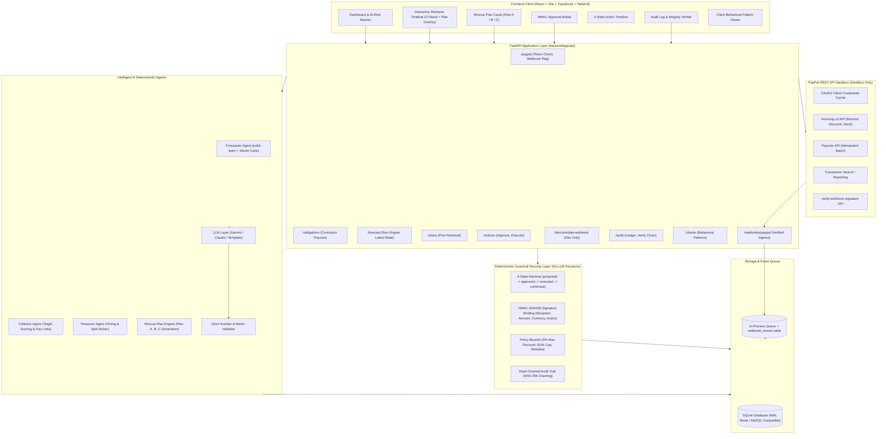

# Cashflow Lifeline: System Architecture

**PayPal AI Hackathon ("Build What's Next with PayPal and AI")**

Cashflow Lifeline finds the one upcoming payment a PayPal-paid freelancer is about to miss, compares the cheapest ways to protect it, and executes the plan the owner approves through PayPal.

---

## 1. High-Level Architecture Diagram

---

## 2. Agent Responsibilities & Boundaries

| Component | Responsibility | Boundary & Constraints |
|---|---|---|
| **Forecaster Agent** | Fits statistical payment delay models, runs 1,000 Monte Carlo trajectories, detects first shortfall date and amount, ranks driver clients. | Strictly mathematical and statistical. Cannot approve plans. |
| **Collector Agent** | Scores and ranks clients using: $\text{Score} = (\text{Amount}/\text{Shortfall}) \times (1 - p_{\text{late}}) \times W_{\text{rel}}$. Selects optimal targets for reminders vs discount concessions. | Computes candidate rankings and explanations. Never approves or executes. |
| **Treasurer Agent** | Ranks upcoming obligations by urgency; calculates feasible 2-stage installment schedules within available balance and future inflow timings. | Evaluates split timing. Direct cash cost is \$0.00. |
| **Rescue Plan Engine** | Generates exactly three plans per shortfall: Plan A (Reminders), Plan B (Early-Pay Discount), Plan C (Contractor Split). Attaches with/without projections and late scenarios. | Never presents any plan as guaranteed. Must state "plausibly protects". |
| **Guardrail Agent** | Enforces 4-state state machine, validates HMAC approval hashes, checks policy bounds, appends hash-chained audit blocks. | Deterministic Python code only. Zero LLM involvement. Rejects illegal transitions. |
| **LLM Service** | Generates natural language driver summaries, plan trade-off reasoning, and polite message drafts. | Strictly restricted to prose. All numbers pass through `validate_llm_numbers()`. Any discrepancy falls back to deterministic templates. |

---

## 3. Data Flow: The End-to-End Lifeline Cycle

1. **Baseline Assessment**:
   - The user opens the dashboard. Current balance is healthy (\$1,800.00).
   - Contractor obligation: Marcus Sterling, \$3,200.00 due on Friday.
2. **Shortfall Detection**:
   - Forecaster Agent computes open invoices:
     - Apex Design Studio (\$2,000.00 due in 2 days) typically pays 14 days late $\rightarrow$ cash arrives after Friday!
     - Nordic Data Labs (\$1,500.00) arrives with 6-day lag.
   - Projected balance on Friday drops to **-\$1,400.00** (Shortfall Amount: \$1,400.00).
   - Monte Carlo simulation reveals an **85% probability of shortfall**.
3. **Rescue Plan Generation**:
   - Engine creates Plan A (\$0.00 cost), Plan B (\$60.00 discount cost), and Plan C (\$0.00 cash cost split).
   - Each plan includes an exact `Action` in `proposed` state with a pre-computed HMAC signature.
4. **Owner Review & Signed Approval**:
   - Owner reviews the side-by-side cards. Owner selects Plan A and clicks **"Approve Exact Action"**.
   - Guardrail verifies HMAC signature against `(recipient, amount, currency, action_type, idempotency_key)`.
   - Action moves from `proposed` $\rightarrow$ `approved`. Audit block appended.
5. **Sandbox Execution**:
   - Owner clicks **"Execute in PayPal Sandbox"**.
   - ActionExecutionService dispatches PayPal Invoicing reminder API with live payment link.
   - Action moves from `approved` $\rightarrow$ `executed`.
6. **Payment Confirmation & Recalculation**:
   - Client pays invoice in PayPal sandbox (or fast-tracked via "Simulate Client Payment" button).
   - Webhook arrives at `/webhooks/paypal`. Cryptographic signature verified against PayPal sandbox API.
   - Event queued and processed. Action moves from `executed` $\rightarrow$ `confirmed`.
   - Forecaster recalculates: cash balance rises to \$3,800.00.
   - At-Risk banner updates to: **"Obligation Protected — \$3,200.00 Covered"**.

